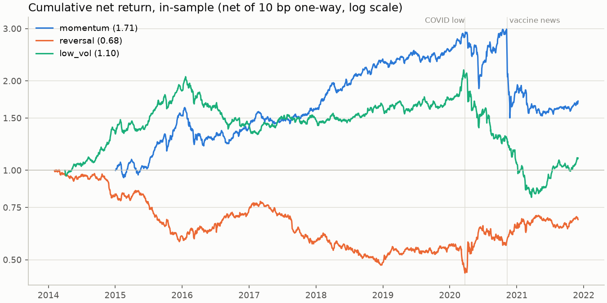
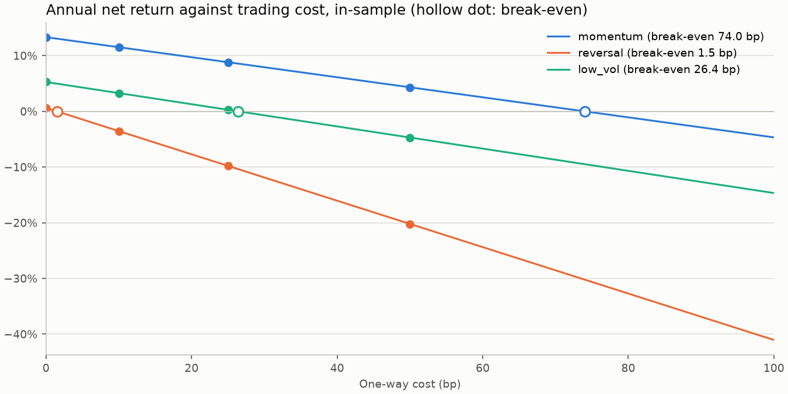

# factor-backtest

A cross-sectional equity factor backtesting engine, written from scratch in Python
(personal project, August 2026 – present). Momentum, short-term reversal and
low-volatility factors are sorted into monthly decile portfolios on UK equities
(WRDS Compustat Global, 2014–2024), executed at the next close and charged trading costs.

**Status:** the data pipeline, factors, portfolios, backtest and in-sample report are done.
The holdout (2022–2024) is still locked; pre-registered momentum variants come next.

## Design principles

- **No look-ahead.** A signal at date t uses data up to t's close; positions are
  executed at the next close.
- **Missing data is never filled.** A missing price or return stays missing. A position whose
  price is missing is valued at its last observed price, which also settles delisted stocks.
- **Locked holdout.** Everything from 2022-01-01 is held out and was fixed before any result
  was seen (`config.HOLDOUT_START`). The code refuses to report it until
  `config.HOLDOUT_UNLOCKED` is set: a one-way switch whose commit records when the holdout
  was first used.
- **Realistic execution.** Stocks that do not trade on the execution day are dropped and each
  leg is re-scaled; every trade pays a one-way cost, and the break-even cost is reported.
- **Fail loudly.** Every module validates its output (shapes, warm-up rows, bucket sizes, leg
  sums, aligned panels, daily returns compounding to period returns) and raises instead of
  silently continuing.
- **Reproducible data.** `prepare_wrds.py` refuses any input other than the audited file, and
  the same input always produces a byte-identical output.

## Repository layout

| File                            | Purpose                                                                                       |
|---------------------------------|-----------------------------------------------------------------------------------------------|
| `config.py`                     | All settings: data source, lookbacks, rebalancing, costs, price floor, holdout                |
| `prepare_wrds.py`               | Cleans the raw WRDS file into the engine's input (rules in `docs/`)                           |
| `data_loader.py`                | The only data boundary: long file to wide date × symbol panels, cached as parquet             |
| `factors.py`                    | Momentum (12-1), reversal (1 month), low volatility (60 days)                                 |
| `portfolio.py`                  | Month-end decile sorts, 10p price floor, equal-weight long-short weights                      |
| `backtest.py`                   | Executes weights at the next close, values positions, charges costs; metrics and holdout lock |
| `report.py`                     | Runs every factor and writes tables and figures to `results/`                                 |
| `results/in_sample.md`          | In-sample results: performance, costs, execution, drawdowns, worst-month attribution          |
| `docs/data_audit_wrds_uk.md`    | Data audit: each cleaning rule, its assumptions and the evidence for them                     |
| `docs/wrds_clean_manifest.json` | Run record of the cleaning: rows changed by each rule, parameters, output hashes              |

## Data

| Source    | Description                                                                        | Included                               |
|-----------|------------------------------------------------------------------------------------|----------------------------------------|
| Synthetic | 1,000 simulated stocks, 2014–2024, used to build and test the engine               | No (109 MB, above GitHub's file limit) |
| WRDS      | Compustat Global, London Stock Exchange, 2014–2024; 1,955 companies after cleaning | No (licensed)                          |

The WRDS data cannot be redistributed. The audit in
[`docs/data_audit_wrds_uk.md`](docs/data_audit_wrds_uk.md) documents what the raw data
contain, what is wrong with them (rights issues adjusted as splits, a 2017 volume gap,
duplicate share lines, stale prices) and how each problem is handled.

To rebuild the WRDS input with your own access: download the data as described in
Section 1 of the audit, place the file at `data/wrds_uk_prices.csv.gz` (its SHA-256 must
match `config.WRDS_SHA256`) and run `python prepare_wrds.py`. It writes
`data/wrds_clean.csv.gz` and the run record `docs/wrds_clean_manifest.json`, so the run can
be checked against the audit and against the committed output hashes.

## How to run

```bash
conda env create -f environment.yml
conda activate quant

python prepare_wrds.py   # WRDS only: clean the raw file into data/wrds_clean.csv.gz
python data_loader.py    # build and cache the panels
python factors.py        # compute and validate the three factors
python portfolio.py      # build month-end decile portfolios
python backtest.py       # self-check of execution, valuation and costs (no returns printed)
python report.py         # in-sample tables and figures, written to results/
```

Set `SOURCE` in `config.py` to `"wrds"` (default) or `"synthetic"`. Neither data file is in
the repository, so the commands need the matching input file in `data/`.

## Results (in-sample)

In-sample holding periods end before 2022-01-01; the holdout has not been run. Equal-weighted
decile long-short portfolios, formed at month-end, executed at the next close, net of 10 bp
one-way. The numbers below are taken from [`results/in_sample.md`](results/in_sample.md),
written by `report.py` at tag `baseline-in-sample`; that file also has execution statistics,
drawdown dates and the positions behind each factor's worst month.

| Factor                   | Months | Net mean (ann.) | Sharpe | t (NW) | Max drawdown | Break-even (bp) |
|--------------------------|-------:|----------------:|-------:|-------:|-------------:|----------------:|
| Momentum (12-1)          |     83 |          11.52% |   0.45 |   1.42 |       −49.7% |            74.0 |
| Reversal (1 month)       |     94 |          −3.54% |  −0.22 |  −0.60 |       −55.1% |             1.5 |
| Low volatility (60 days) |     92 |           3.27% |   0.17 |   0.41 |       −62.8% |            26.4 |





- **Momentum** is the only factor with a wide cost margin: break-even 74 bp one-way, against
  26 bp for low volatility and 1.5 bp for reversal. Its risk sits in one episode: after the
  vaccine news of November 2020 the stocks it was short (cinemas, travel, events) rallied,
  and the portfolio lost 42.5% in one month.
- **Short-term reversal** earns about zero before costs once trades execute at the next close,
  which removes most of the bid-ask bounce; with about 3.5 times the portfolio traded each
  month, it loses money at any realistic cost.
- **Low volatility** doubled in 2014–15 and then went sideways until 2020. The long-short
  portfolio is short high-beta stocks, so the rebound of high-volatility small caps in
  2020–21 produced its deepest drawdown.
- **No t-statistic exceeds 2.** With about seven years in-sample, even a true Sharpe ratio of
  0.75 would reach t > 1.96 only about half the time, so these results cannot separate a
  modest premium from none. They are reported as they are; no setting was tuned to them.

## Next steps

1. Pre-register momentum variants (volatility scaling, beta hedging, residual momentum,
   holding buffers) and the decision rule in `docs/research_plan.md`, committed before any
   variant is run.
2. Robustness checks: 20p price floor, liquidity screen, −30% return on non-cash delistings,
   sub-periods, short-side financing.
3. Unlock and run the holdout once, after the design is final, and report every
   pre-registered result.
