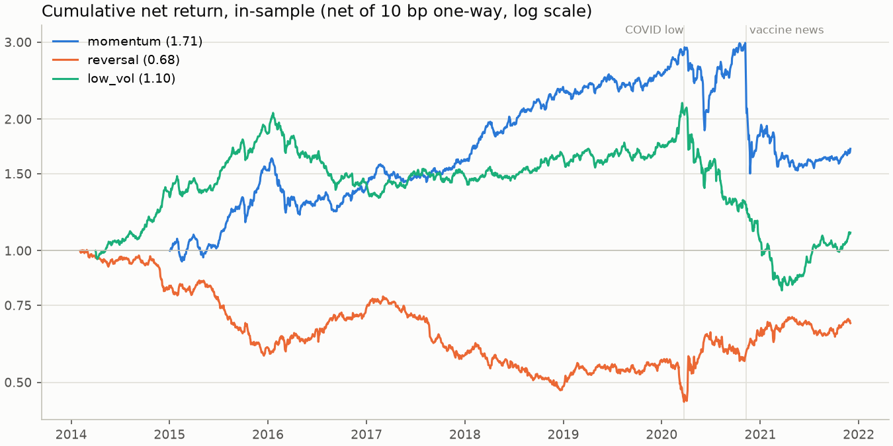
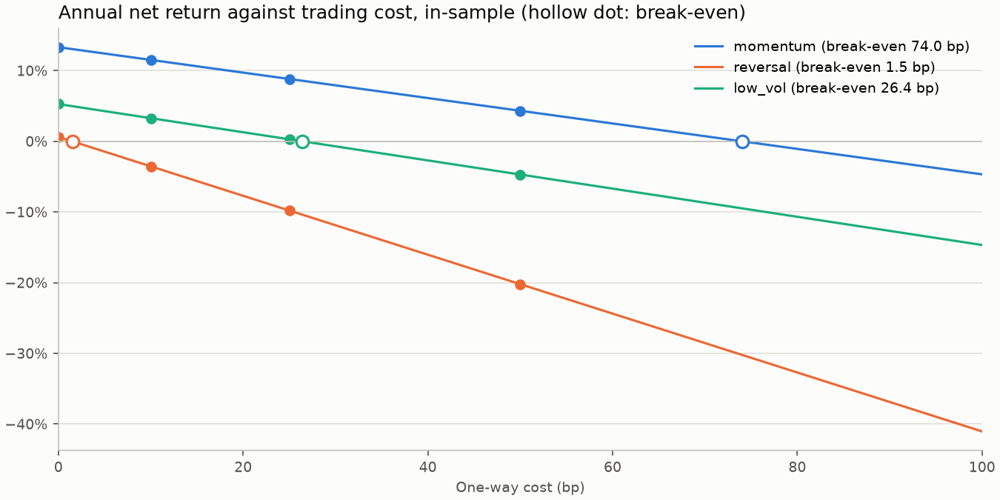

# In-sample results

In-sample: holding periods ending before 2022-01-01. Source wrds; 10 buckets, equal-weighted long-short; price floor 0.10 GBP; executed at the next close; net of 10 bps one-way unless stated.

## Performance

| factor   |   months |      first |       last |   mean |    vol |   Sharpe |   t (NW) |   hit |   max DD |   long |   short |
|:---------|---------:|-----------:|-----------:|-------:|-------:|---------:|---------:|------:|---------:|-------:|--------:|
| momentum |       83 | 2015-01-02 | 2021-12-01 | 11.52% | 25.33% |     0.45 |     1.42 | 63.9% |   -49.7% | 23.59% |  10.27% |
| reversal |       94 | 2014-02-03 | 2021-12-01 | -3.54% | 16.41% |    -0.22 |    -0.60 | 45.7% |   -55.1% |  9.19% |   8.56% |
| low_vol  |       92 | 2014-04-01 | 2021-12-01 |  3.27% | 19.75% |     0.17 |     0.41 | 56.5% |   -62.8% | 10.51% |   5.24% |

## Costs: break-even and mean net return at each one-way cost

| factor   |   turnover |   cost/yr |   break-even bp |   @0bp |   @10bp |   @25bp |   @50bp |
|:---------|-----------:|----------:|----------------:|-------:|--------:|--------:|--------:|
| momentum |       1.47 |     1.77% |            74.0 | 13.32% |  11.52% |   8.82% |   4.32% |
| reversal |       3.49 |     4.18% |             1.5 |  0.62% |  -3.54% |  -9.79% | -20.21% |
| low_vol  |       1.65 |     1.99% |            26.4 |  5.27% |   3.27% |   0.28% |  -4.70% |

## Execution: share of target positions dropped at the next close

| factor   |   positions |   dropped long |   dropped short |
|:---------|------------:|---------------:|----------------:|
| momentum |         172 |          3.49% |           5.35% |
| reversal |         180 |          5.10% |           3.62% |
| low_vol  |         178 |         11.96% |           4.05% |

## Deepest drawdown and worst month

| factor   |       peak |     trough |   drawdown |   worst entry |   worst net |
|:---------|-----------:|-----------:|-----------:|--------------:|------------:|
| momentum | 2020-11-06 | 2020-11-24 |     -49.7% |    2020-11-02 |     -42.52% |
| reversal | 2014-02-28 | 2020-03-24 |     -55.1% |    2020-03-02 |     -15.89% |
| low_vol  | 2020-03-17 | 2021-03-22 |     -62.8% |    2020-04-01 |     -23.64% |

## Worst month: the five largest losses by position

| factor   | symbol   | company                     |   weight |   move |   contrib |
|:---------|:---------|:----------------------------|---------:|-------:|----------:|
| momentum | 284533   | CINEWORLD GROUP             |   -1.20% | 125.5% |    -1.51% |
| momentum | 321365   | METRO BANK HOLDINGS PLC     |   -1.20% | 109.3% |    -1.32% |
| momentum | 204495   | HYVE GROUP PLC              |   -1.20% |  96.1% |    -1.16% |
| momentum | 325157   | THE INCE GROUP PLC          |   -1.20% |  95.1% |    -1.15% |
| momentum | 318012   | SSP GROUP PLC               |   -1.20% |  88.2% |    -1.06% |
| reversal | 271364   | SYNAIRGEN PLC               |   -1.20% | 254.3% |    -3.06% |
| reversal | 239600   | INDIGO VISION GROUP PLC     |   -1.20% |  88.1% |    -1.06% |
| reversal | 211976   | FRENCH CONNECTION GROUP PLC |    1.15% | -82.5% |    -0.95% |
| reversal | 101924   | PREMIER OIL PLC             |    1.15% | -79.5% |    -0.91% |
| reversal | 331934   | WIZZFINANCIAL               |    1.15% | -78.8% |    -0.91% |
| low_vol  | 284276   | GENEDRIVE PLC               |   -1.22% | 330.2% |    -4.03% |
| low_vol  | 209258   | TULLOW OIL PLC              |   -1.22% | 142.9% |    -1.74% |
| low_vol  | 100088   | COSTAIN GROUP PLC           |   -1.22% | 122.7% |    -1.50% |
| low_vol  | 318815   | BIODEXA PHARMACEUTICALS PLC |   -1.22% | 114.6% |    -1.40% |
| low_vol  | 327578   | AMIGO RESOURCES PLC         |   -1.22% | 103.3% |    -1.26% |
